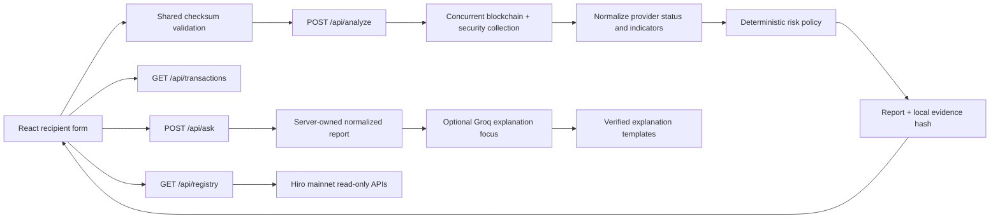

# Architecture

TxGuard retains its existing React/Vite + Vercel monorepo and five provider integrations. There is no user database, login requirement or payment processor. An existing Upstash Redis service is required for shared production request quotas. The separate Clarity project preserves its deployed ABI. The local Express simulator never feeds production results.

## Files and boundaries

- `web/src/App.jsx`: scan orchestration, navigation and local wallet/history state. `Dashboard`, `Report` and receipt tools load on demand. One responsive tree replaces duplicated desktop/mobile content.
- `web/shared/chains.js`: shared mainnet validation, safe explorer URLs, exact decimal units, timestamps and canonical wallet keys. No server credentials.
- `web/src/blockchain.js`: existing adapter location retained, now server-only. Etherscan V2 native/token activity, Blockstream multi-output interpretation, Hiro status distinctions, bounded Solana details. It must not be imported by browser components.
- `web/src/riskEngine.js`: GoPlus response validation and deterministic policy. No behavioral bonuses based on age/wealth or fabricated categories.
- `web/server/http.js`: request policy, body validation, upstream bounds, rate limits and caches.
- `web/server/rate-limit.js`: atomic Redis client, endpoint and application quotas, HMAC client identifiers, environment isolation and fail-closed production behavior. See [configuration and fixed-window limits](production-environment.md).
- `web/server/etherscan.js`: server-only V2 chain IDs 1/56, bounded cached reads, safe credential/plan/rate-limit errors and local cooldowns. Missing credentials never become empty successful history.
- `web/server/scan.js`: parallel collection, normalized evidence, 60-second scan cache, 15-minute local chat-context retention, evidence SHA-256. All are bounded and ephemeral.
- `web/server/ai.js`: optional Groq request; model selects only one allowed explanation focus and repeats the exact signal IDs. Server-generated factual prose prevents fabricated transactions or additional checks. There are no automatic inference retries.
- `web/server/registry.js`: interface compatibility and successful anchored call verification. It neither signs nor submits transactions.
- `web/vite.config.js`: local serverless adapter, same handlers and 8 KB body cap as application policy. Vite secret variables stay server-side.
- `web/src/prerender.jsx` and `web/scripts/prerender.mjs`: render public homepage HTML at build time, without provider calls or user data. Critical CSS and licensed local fonts load directly; a small loader starts React hydration after the first paint opportunity. Form fields remain disabled until hydrated. Bundle failure retains public content and offers reload recovery. Dashboard/history hash routes reconcile after hydration.

## HTTP API

| Route | Method | Input | Result |
| --- | --- | --- | --- |
| `/api/analyze` | POST | `{wallet, chain, token?, amount?}` | Live recipient report; null risk on insufficient security evidence |
| `/api/transactions` | GET | `wallet`, `chain` query | Recent actual activity and scope limitations; 503 on unavailable provider |
| `/api/ask` | POST | `{wallet, chain, scanId, question}` | Verified contextual explanation + source; fresh evidence if context expired/on another instance |
| `/api/registry` | GET | Optional `txid` | Deployed ABI compatibility or existing transaction confirmation |
| `/api/tts` | POST | `{text}` up to 200 characters | Bounded audio proxy response or honest 503 |
| `/api/report-bug` | POST | JSON object | Honest 503 with public issue URL until durable reporting is configured |

Unsupported methods are 405; invalid input 400; unsupported media 415; over-limit bodies 413; foreign browser origins 403; quota exhaustion 429 with Retry-After. Unavailable production request protection is 503 before provider/AI work. Same-origin browser access needs no wildcard CORS. URLs for providers are fixed; users cannot select upstream hosts. Provider HTTP requests reject redirects and have a seven-second abort deadline and 2 MB streaming response cap. Redis REST responses have a two-second deadline and 4 KB streaming cap. Core scan collectors run concurrently; Solana transaction details use at most three concurrent requests across two batches.

## Persistence, freshness and privacy

Saved public addresses use the existing `txguard_tracked_wallets` localStorage key. Valid old addresses/names survive migration; old unversioned balances/scores are discarded. New assessments carry policy and timestamp. Failed refreshes clear their assessment rather than retaining a stale reassuring label. The last 20 scan summaries use `txguard_scan_history`; users can clear them. Demo fixtures are never saved as live scans. Storage failures are recoverable. No private keys, wallet permissions or seed phrases are requested.

Scans cache per canonical network/address for 60 seconds; successful history requests for 30 seconds. Identical in-flight work is deduplicated. Total collector failure is not cached as clean coverage. Refresh can reuse data still within TTL, with its original assessment timestamp visible. Cached reports and bounded local context disappear on instance recycle. AI gets normalized signal IDs and coverage, not raw token names, HTML or user-supplied summaries. Addresses go to relevant blockchain and security providers. Optional device speech may use the browser's selected speech service; fallback audio sends summary chunks to the configured fixed Google TTS endpoint.

The local report hash commits to JSON of policy, wallet, chain, timestamp, score and normalized signals in that order. It is not signed or onchain and does not prove issuer identity. The legacy registry stores plaintext targets/scores and submitters, not this evidence hash. Each call appends a scan record and updates a per-target count and global counter; storage grows with submissions. Mainnet write fees and storage costs have not been measured because paid writes are outside scope. Receipt verification checks contract/function identity, success, canonical flag, anchored state and height; it does not automatically associate an arbitrary existing receipt with the current report.

## Remaining operational boundaries

Redis configuration and actual cross-instance behavior remain unverified without credentials. Mock tests cover concurrent instances, global ceilings, reset, outages and spoofing; they do not prove live account access. Additional edge controls can protect against volumetric traffic. Read-only registry checks trust Hiro responses, not an independently operated Stacks node. No backend account access or scan-purchase/replay logic exists. Etherscan credentials and plan support remain prerequisites for EVM balances/history. Groq is optional and live inference has not been verified without credentials.
